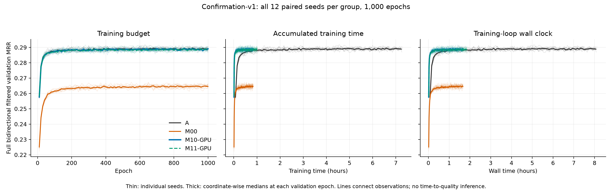

# M10 研究主线：论点、证据与贡献定位

日期：2026-11-17。用途：导师讨论与论文框架。本文为封存结果后的解释和补充分析，不修改 confirmation-v1 的实验身份，也不启动新实验。

## 1. 证据身份和统计角色

论文以 M10 为主要结果、M11 为去重补充；原冻结协议以 M11 为主判断、M10 为预先声明的省时备选。论文角色调整是在结果出来后作出的，不能将 M10 的次要结果改称事先指定的主要确认结果。A/M10 的补充速度比较也是事后分析；本文件不改写原 `joint_supported` 判断。

原始结果来自 204 项有效任务，无缺失配对：S 72 项、T 36 项、Q 48 项、E 48 项。存在两次基础设施干扰失败及一次人工授权恢复，成功尝试、失败尝试和恢复记录均保留。此前的独立核验覆盖 204 项任务及 7,202 个清单条目；本次仅复算本文使用的汇总和检查曲线输入，不声称重新执行训练或独立复现实验。

| 证据编号 | 材料与定位 | 本文用途 |
|---|---|---|
| E1 | [确认结果总结](CONFIRMATION_RESULTS_2026-11-17.md)、[原始分析报告](../../output/results/confirmation_v1/analysis-01/REPORT.md) | 全部组的质量、速度、头尾指标、恢复及限制 |
| E2 | [机器可读汇总](../../output/results/confirmation_v1/analysis-01/summary.json)：`quality`、`speed` | 已定义的配对比较、种子列表、比值及区间 |
| E3 | [逐任务复算记录](../../output/results/confirmation_v1/analysis-01/recomputed_tasks.json)：`task.kind/group/seed` | 补充 A/M10、M11/M10 速度及 Q 墙钟的复算 |
| E4 | [冻结清单](../../output/results/confirmation_v1/run-01/freeze.json)、[协议](CONFIRMATION.md) | 固定配置、种子、任务顺序和测试闸门 |
| E5 | [机制结果](MECHANISM_RESULTS_2026-11-09.md)、[机制解释](MECHANISM_INTERPRETATION_2026-11-09.md) | 四组因素对照、固定参数的权重与梯度观测 |
| E6 | [旧 A/B/C 结果](FINAL_RESULTS_2026-11-08.md) | 质量失败的研究动机；不并入当前配对统计 |
| E7 | [采样实现](../../src/py/experiments/formal_v1/mechanism_sampling.py)：`PolicySampler.generate`；[训练与评估](../../src/py/experiments/formal_v1/confirmation_jobs.py)：`build/update_epoch/evaluate` | 精确规则、计时边界、数据过滤和选模 |
| E8 | [复核程序](../../output/results/confirmation_v1/execution-02/verify_confirmation.py)、[复核回执](../../output/results/confirmation_v1/execution-02/verification.json) | 已有原始排名、区间和归档校验依据 |

E3 及完整 checkpoint、原始排名保存在实验主机，不保证全部进入 GitHub；仓库中的精选材料与本地完整产物分开说明。不能因仓库缺少大文件而把未重新运行的核验写成已重现。

关键身份：

```text
run-01/freeze.json
e695ba6f688dcc8428da9023bc3ce20f2df4f9cbb4456672e5b4b9237818d855
analysis-01/summary.json
8f5472ab291b007699e7ee3321115cfb20ec42541fb44840f52feb778b789ebd
analysis-01/recomputed_tasks.json
9f5d28ed4b398cad935fa5b6e138d7b9946f07509bc19f90a4ff9b12d2aa1fb8
analysis-01/artifacts.json
acf144b4aad6b82e31368d4773cd29460906960ddb248d5e3e0a7cb857bf6b4f
run-01/artifacts.json（封存运行的清单，亦为归档身份）
2201c903a9e4d259a4192743eb2838f5ff73b6c8c7e266eaaa40068438a8bdf4
```

## 2. 核心论点与证据对应

| 编号与论点 | 比较、证据和结果 | 控制因素与推理 | 可用措辞及不可推出的结论 |
|---|---|---|---|
| C1：M10 达到历史 A 的质量门槛 | E1–E3；E 测试，501–512，12 对；M10/A＝0.9987，95% CI [0.9958, 1.0017] | 同种子配对初始化和正样本顺序；训练预算与选模规则共同；区间下界高于 0.95 | 当前配置中支持质量门槛。属于预设次要比较；不宣称完全等价、统计优越或全新盲测确认 |
| C2：方向组织改变质量表现 | E2；同期 E 的 M10/M00＝1.0886，[1.0853, 1.0918]，12 对；E5 四组训练使用 401–403 三个种子 | GPU、模型、过滤和允许重复等共同；改变每行 75+75 与随机单方向 150 的组织方式 | 该方向组织干预在所测条件下改善质量；不是所有方向选择方案的普遍排序 |
| C3：整体 M10 方案显著缩短训练轮 | E3；S 的 A/M10＝8.4368，[8.3489, 8.5255]；521–532，12 对 | 每项先平均五个测量轮，包含短批、采样、传输和更新 | 相对历史 A 的整套方案收益；补充的事后速度比较，不归因于单一规则或纯 GPU 设备 |
| C4：相同新规则下 GPU 路径更快 | E2；S 的 M10-CPU/M10-GPU＝3.5532，[3.5312, 3.5753]；12 对 | 共用张量采样实现；CPU 生成负样本后传入 GPU；模型均在 GPU 训练 | 同规则完整训练轮的执行路径收益；不是 CPU 与 GPU 独立训练模型、纯内核加速或 CPU/GPU 样本逐项一致 |
| C5：采样是主要节省来源 | E3、E7；T，541–546，6 对；完整批 A→M10：采样 414.730→7.074 ms，step 465.882→54.470 ms | 独立进程分阶段同步，完整批与短批分别汇总；其余阶段变化较小 | 时间构成支持主要节省来自负样本生成；阶段均值用于解释，不替代 S 或证明单个内核的因果贡献 |
| C6：去重增加成本，额外质量收益不明确 | E2–E3；E 的 M11/M10＝1.0016，[0.9987, 1.0045]；S 的耗时比＝1.2198，[1.2179, 1.2216] | M11 相对 M10 增加同行唯一约束；方向规则等共同 | 每轮多耗时约 21.98%，当前未明确支持额外质量收益；区间跨 1 不证明去重无效或两组等效 |
| C7：自对抗权重竞争是解释线索 | E5；两个已训练锚点的 M00 头负项权重约 60%–61%；分方向归一化改变即时梯度 | 固定参数和输入，比较候选、权重与梯度；锚点来自不同轨迹 | 与权重竞争解释一致；没有证明共享 softmax 独自导致最终质量差异，亦不是同一模型的纵向演化证据 |

质量比较使用 E 的最佳验证 checkpoint 测试结果；机制四组比较使用验证集。确认阶段没有 M01 的 12 种子质量任务，不能把三种子的完整因素对照写成 12 种子因素实验。

每项区间以种子为独立单位，在配对比值的对数尺度计算双侧 95% t 区间。轮、批、查询和固定锚点内样本不能扩充独立样本数。所有次要比较区间未经多重比较校正；0.95 是原设计的工程容忍门槛，不能改成新颖性或普适等效标准。

## 3. 最近工作的定向核对

检索与访问日期：2026-11-17。范围为旧审计七项候选，加相邻 Fast KGC 与解释方向规则所必需的 RotatE。本文核对相关章节和官方代码，不声称逐字通读所有论文或完成截至该日期的系统综述。旧 [C1 门槛](../phase_x_x1_5_part4_c1_gate_closure.md) 继续为 UNRESOLVED，旧 [映射](../phase_x_x1_5_part3_mapping_synthesis.md) 不修改。旧资料中部分布尔标记存在快照差异，本文以可定位原文为依据，不继承标记作为结论。

| 工作／旧记录 | 本次读取位置与可以确认的事实 | 对本研究定位的影响及尚未核实项 |
|---|---|---|
| DGL-KE；rec-49d37e2cf4399d16 | [论文 §3.3、§6.1.1–6.1.2](https://arxiv.org/pdf/2004.08532)：CPU 采样、组内共享负样本、张量化评分，并评价速度与采样相关质量变化；[官方 sampler](https://github.com/awslabs/dgl-ke/blob/master/python/dglke/dataloader/sampler.py) 的 `create_sampler` 提供 `exclude_positive` 参数 | 采样与系统效率的联系已有先例。其共享候选策略与当前逐正样本组织不同；参数存在不等于每个实验启用严格训练真三元组过滤。当前未建立同配置性能比较 |
| SMORE；rec-37283377cfa3766c | [论文 §3.2、附录 C](https://www-cs.stanford.edu/~jure/pubs/smore-kdd22.pdf)：面向查询的双向拒绝采样，批内共享负答案，多 GPU 与 CPU 参数存储 | “双向”是查询计算中的正反搜索，不等于每条正样本的头尾 75+75。在线采样与执行协同已有工作；其方向、重复、损失不能直接映射为本研究四组 |
| Efficient KGE Training Framework with Multiple GPUs；rec-287dd98564698ec3 | [出版方摘要](https://www.sciopen.com/article/10.26599/TST.2021.9010067)：分区、细粒度 GPU 调度及负载平衡以减少 IO 并加速训练 | 只核实题录与摘要；本次未取得可读全文，具体负采样方向、过滤、去重和损失均未核实。不能据此声称其没有质量评价或与 M10 无重合 |
| PyTorch-BigGraph；rec-6eb043c469e35a30 | [论文 §4.3、Fig.3](https://proceedings.mlsys.org/paper_files/paper/2019/file/1eb34d662b67a14e3511d0dfd78669be-Paper.pdf)：批量负采样和组内复用实体，将评分组织为矩阵计算 | 张量化和减少数据移动不是新的总体思想。本文读取不足以确认其每项训练的全部真三元组过滤、同行唯一及方向安排，不将这些项编码为不存在 |
| Marius；rec-94cf218c869781d0 | [论文 §3、§5.1–5.2](https://www.usenix.org/system/files/osdi21-mohoney.pdf)：流水线、分区缓存与数据顺序；比较运行时间及质量，评价采样与初始化实现差异 | “同时评价效率和质量”已有先例。本研究的对象是 muKG 采样规则与驻留 GPU 的小图训练；尚未审计 Marius 完整采样源码，不作纯设备或框架优劣结论 |
| NSCaching；rec-4f24693ca07812a8 | [论文 §III、Algorithms 2–3、§IV](https://arxiv.org/pdf/1812.06410)：维护头尾缓存，从缓存选负样本并依据分数更新缓存，评价质量与时间 | 属于改变候选分布的相关负采样方法。M10 使用均匀候选加已有自对抗权重，不等同缓存机制；没有复现 NSCaching，不能宣称速度或质量胜过它 |
| MariusGNN；rec-c92dbdfaf6eeb135 | [原文 §7.5、Table 8](https://arxiv.org/html/2202.02365v2)：COMET 讨论磁盘训练的数据顺序、速度及 MRR，也含 DistMult 对照 | 不能仅因题名含 GNN 就排除其 KGE 相关证据。主要干预是数据组织和分区替换；不能据此推断其负采样细节与 M10 等同或不同 |
| Fast KGC；相邻 rec-1d7e5d1df9000775 | [作者稿摘要、§3–4](https://arxiv.org/pdf/2307.12059)：利用已有嵌入将补全检索转换为度量空间相似连接并在 GPU 执行 | 主要对象是已有嵌入后的补全计算，和训练负采样的阶段不同；不能拿其 GPU 加速数字作为训练轮对照 |
| RotatE；本次必要关联工作 | [论文 §3.3、式(5)–(6)](https://arxiv.org/pdf/1902.10197) 给出自对抗负项权重；[官方 dataloader](https://github.com/DeepGraphLearning/KnowledgeGraphEmbedding/blob/master/codes/dataloader.py) 的 `TrainDataset.__getitem__` 按指定端生成整行、过滤训练真三元组且不去重，`BidirectionalOneShotIterator` 交替头尾批次；[官方 model](https://github.com/DeepGraphLearning/KnowledgeGraphEmbedding/blob/master/codes/model.py) 的 `train_step` 对一行负项 softmax 加权 | 单方向一行负样本与自对抗加权已有明确先例。M10 每条正样本重新随机选端，官方实现按批次交替，二者不能宣称相同联合分布；NumPy/CPU 采样与本研究 GPU 张量拒绝采样也不同 |

代码链接指向本次访问的 master 文件，不冒充论文发布时的固定 commit；正式投稿前若依赖源码级比较，应固定对应版本并保留快照。DGL-KE 的旧 Amazon PDF 地址本次返回 404，已改读作者 arXiv 稿；OpenReview PDF 遇到浏览器验证，RotatE 改读作者 arXiv 稿；MariusGNN PDF 超时后改读作者 HTML；这些失败不被当成方法不存在的证据。

### 最接近规则的六项语义核对

| 对象 | 选端单位 | 原正样本／训练真三元组 | 重复 | 自对抗加权 | 采样执行位置 | 已有质量证据 |
|---|---|---|---|---|---|---|
| 本研究 M00 | 每行固定 75 头＋75 尾 | 严格过滤，最多 64 轮，耗尽失败 | 允许 | 全行共同归一化 | GPU | 本配置 12 种子官方测试 |
| 本研究 M10 | 每次呈现的每条正样本随机选一端，各 1/2；同行 150 个同向 | 同上 | 允许 | 同上，单行只有一种方向 | 匹配 CPU/GPU；训练模型均在 GPU | GPU 质量 12 种子；CPU 路径只有 S/T，未完整训练做质量比较 |
| 本研究 M11 | 同 M10 | 同上并检查唯一候选容量 | 同行去重 | 同 M10 | 匹配 CPU/GPU | 同上 |
| RotatE 官方代码 | 头批次和尾批次交替；每行服从该批次方向 | 按训练真头／尾集合拒绝候选 | `randint` 后未同行去重 | `train_step` 的负项 softmax | NumPy/CPU 生成，可传 CUDA 训练 | 本次未重跑；论文数字不作为同配置基线 |
| DGL-KE 论文与 sampler 接口 | 组内共享头或尾候选；接口支持模式指定，实际调用顺序未核实 | 接口有过滤选项，具体实验启用情况未核实 | 当前读取范围未核实 | 当前读取范围未核实 | 论文 §3.3 明确 CPU 采样 | 论文有质量评价；未同配置重跑 |

### 当前可用的贡献定位

推荐表述：在 muKG 的指定 TransE、自对抗损失和 FB15k-237 条件下，对方向组织和去重进行对照，展示一个达到历史质量门槛的 GPU 张量采样方案，并通过匹配 CPU/GPU 和独立阶段计时区分收益来源。

该表述说明本研究提供的具体证据，不保证已达到目标会议的新颖性要求。最近工作已经涉及单方向、自对抗权重、批量采样和质量／效率联合评价；研究增量应落在本研究具体干预及证据上，而不能将这些已有组件重新命名为创新。能否构成足够贡献仍需导师结合原文评议。

## 4. 速度定义和实际成本

令 `t[g,s,e]` 为 S 测量轮耗时。每种子先求五轮均值 `t̄[g,s]`，再计算 `r[s]=t̄[numerator,s]/t̄[denominator,s]`；报告 `exp(mean(log(r)))` 及自由度 11 的双侧 t 区间。不能以组间算术均值之比替代配对几何均值。

| 口径 | 数值／材料 | 包含与排除 |
|---|---|---|
| S：历史 A / M10-GPU | 8.4368，[8.3489, 8.5255]；每轮均值 25.242 s / 2.992 s | 完整训练轮，含 54 个完整批和一个 2,115 条短批、批次构造、采样、传输、前后向、更新；排除预热、验证、初始化及轮外日志／资源采集 |
| S：M10-CPU / M10-GPU | 3.5532，[3.5312, 3.5753]；10.630 s / 2.992 s | 两组都用 GPU 模型；CPU 采样组包含负样本 H2D。不是整模型 CPU/GPU 比较 |
| T：完整批 A / M10 / M10-CPU | 采样 414.730 / 7.074 / 143.512 ms；step 465.882 / 54.470 / 194.557 ms | 阶段同步影响时间，不能与 S 混合。采样器内部正样本复制计入采样；模型所用的正样本复制单列 |
| T：短批 A / M10 / M10-CPU | 采样 171.285 / 3.320 / 43.390 ms；step 194.399 / 24.624 / 66.293 ms | 独立汇总；不拿短批差异解释完整批波动 |
| Q：完整任务墙钟 | A 均值 8.0696 h，M10 均值 1.6589 h；均值之比 4.8644 | 成功 worker 的初始化、训练、100 次验证、保存及记录等；描述性均值比较，无配对区间，不含等待或失败尝试 |
| Q：验证成本 | A 0.7671 h，M10 0.7671 h；M10 验证时间／完整墙钟约 46.2% | 每 10 轮完整验证的本协议成本，不代表所有评估频率下的比例 |
| E 与执行总成本 | E 均值 A 37.545 s、M10 37.657 s；成功 worker 合计 161.20 h，失败另 5.03 h，日历跨度约 175.84 h | E 包含过滤构建及双向测试；等待、暂停及派发开销与计算时间区分；预检和最终分析另计 |

S 的显式计时同步放在轮边界，采样实现内部仍存在 `.item()` 等主机检查，不能写成轮内完全无同步。T 的 GPU 负样本传输阶段主要是保持设备及同步开销；不据极小值推断零传输的通用硬件性质。

## 5. 已有验证曲线的补充整理



图使用 E3 的全部 48 项 Q 和 4,800 次完整验证。左：轮数；中：累计完整训练轮时间；右：训练循环墙钟，包含验证及循环内记录等，但不含模型构建等进程前段和任务收尾，因此不等于上一表 Q 完整任务墙钟。所有面板只使用验证 MRR，不使用官方测试指标。

细线为各个种子的原始观测，粗线为每个验证轮次分别计算横纵坐标中位数的描述性轨迹，不是某个实际种子或置信区间。连线仅辅助阅读，不推断两个验证点之间的真实达到时间。不挑选最佳种子，不截取有利轮次，不增加“达到共同质量所需时间”的主判断，也不将曲线平坦写成已充分收敛。

图展示 M10 和 A 在固定轮数下的验证表现接近，而时间横轴明显不同；M00 的质量差异和 M11 的额外时间同时保留。正式测试质量仍引用 C1/C2，不用图上中位数代替。

[绘图源码](figures/plot_confirmation_validation.py) 与 [输入身份和图像哈希](figures/confirmation-validation-2026-11-17.json) 一并保存。脚本固定输入 SHA-256，校验每组种子和 100 次验证，拒绝覆盖已有输出；只读取 E3 的 Q 历史，不重新读取测试排名。可在 worktree 根目录复现至新目录：

```bash
python3 -B docs/formal_v1/figures/plot_confirmation_validation.py \
  --input output/results/confirmation_v1/analysis-01/recomputed_tasks.json \
  --output /tmp/mukg-confirmation-validation-replot.png
```

## 6. 适用边界、异议和补充条件

| 可能异议或缺口 | 当前回答 | 何时需要新增实验 |
|---|---|---|
| 单方向及张量化已被使用，贡献是什么？ | 已有组件不作新算法主张；给出本研究规则干预、质量门槛、匹配执行和去重取舍的具体证据。旧新颖性门槛不宣告关闭 | 若导师认为现有增量不足，先重定贡献；只有直接方法比较能回答明确疑问时，另设计基线实验 |
| A→M10 改了多项规则，能否归因于方向？ | A/M10 只回答整体方案；方向证据来自同期 M10/M00 和四组机制对照，不能相互替代 | 核查发现核心对照仍有未控制变化时，先列混杂，再提出最小干预对照 |
| 是否证明 softmax 导致最终质量变化？ | 没有。训练对照改变方向组织，固定锚点只给出局部解释 | 仅在需要更强因果主张时，设计独立损失归一化控制；先固定采样、初始化、顺序、预算和验证选模，另行讨论组别与预算 |
| 是否适用于其他数据、模型、负样本数和硬件？ | 未检验。当前是单模型、单数据、单硬件和固定配置的条件结论 | 希望扩大该项结论时，新增对应维度并冻结设计；不自动做整套交叉矩阵 |
| CPU/GPU 质量是否相同？ | 匹配采样规则和分布，不保证随机流、浮点执行或训练轨迹逐项一致；CPU 路径没有正式 Q/E | 若要声称设备迁移保持完整训练质量，需另做匹配 CPU/GPU 质量训练 |
| 1,000 轮是否充分收敛？ | 固定预算结果，不声称渐近最优；只依据验证选 checkpoint | 若结论改为最终收敛质量或相同质量达标速度，需先定义停止／阈值及未达标规则 |
| 测试集此前已被使用，是否仍是盲确认？ | 不是整个研究过程的全新盲测。新阶段固定任务和闸门减少阶段内选择，但不消除历史可见性 | 若需独立未见数据确认，另选独立数据并预先冻结；不将新种子当成新数据 |
| 缺少图表、分项汇总或对数区间核对 | 用封存材料复算并标为补充分析，保留失败与缺失状态 | 不需要新训练；材料真有缺失时先收窄结论，不填补推测值 |

当前不启动新实验。每项后续建议须说明疑问、可能结果如何改变主张、最小组别、配对／评估规则、成本和停止条件，经讨论确定后另立冻结版本；不覆盖本轮结果，不追加有利种子。12 个种子的区间仅反映所测条件的种子变异，不覆盖数据集选择、实现偏差或全部硬件差异。
