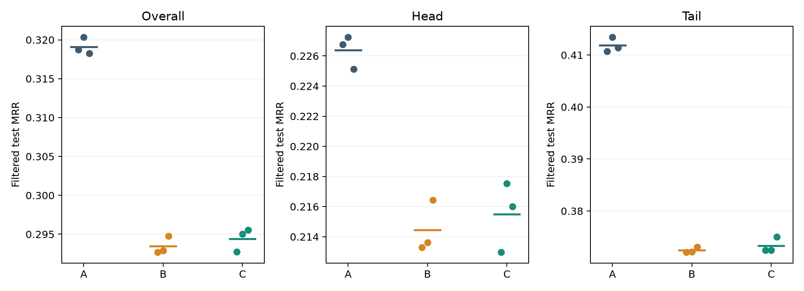
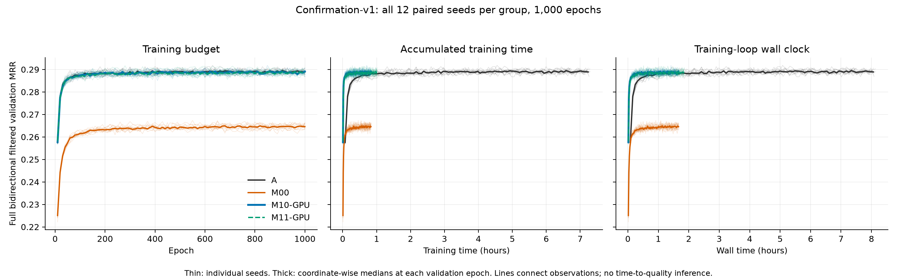

# muKG 负采样方向组织的质量与效率取舍研究报告

日期：2026-11-20。状态：本轮主实验结果定稿，转入论文写作与材料交接。本文是以 M10 为主要结果、M11 为补充的连续正文底稿，不替代封存协议，也不宣告已完成投稿审查或独立训练复现。

## 摘要

负采样的执行方式影响训练开销，采样规则也改变模型接收的训练输入。本研究围绕 muKG 中的 TransE 训练，先通过共同 CPU/GPU 对照发现固定头尾混合规则的质量损失，再用方向组织与去重的四组对照区分设计因素，最后在固定配对种子上确认候选的质量与效率。在 FB15k-237、TransE 250 维 L1、自对抗损失及 RTX 3070 的指定配置下，M10 每条正样本随机选择一端、同行 150 个负样本保持同向并允许重复。12 对官方测试结果中，M10/A 的 MRR 比值几何均值为 0.9987，双侧 95% 区间为 [0.9958, 1.0017]，支持原设计的 0.95 质量门槛。完整训练轮相对历史 A 加速 8.4368 倍，[8.3489, 8.5255]；同规则 CPU/GPU 完整训练轮加速 3.5532 倍，[3.5312, 3.5753]。去重方案 M11 每轮比 M10 多耗时约 21.98%，额外质量收益仍不明确。当前结果支持所测条件内的规则选择和执行取舍，不将单方向规则称为新算法，不将局部权重观测提升为完整因果证明。

原确认协议以 M11 为主判断、M10 为预设省时备选。本文突出 M10 是结果后的论文取舍；M10 质量保持预设次要比较身份，A/M10 速度保持事后补充分析身份。原 M11 的质量与速度主判断均获区间支持，完整保留。官方测试集具有历史可见性，结果适用范围限定于当前数据、模型、预算、实现和硬件。

## 1 引言

知识图谱嵌入训练通常围绕已知三元组构造负样本，再利用评分函数和损失更新实体与关系表示。在每条正样本需要多个负样本时，候选生成、过滤、重试及张量准备会形成额外开销。批量张量操作和 GPU 执行提供了减少这些开销的途径，但硬件迁移经常伴随候选组织和过滤规则的变化。因此，执行速度改善之后，仍需检查预测质量；同时应区分整套方案的收益与相同规则的执行路径收益。

本项目早期探索了成本预测、批次组织和 GPU 原型。后续审计发现，部分成本预测材料不能证明真实未见批次的预测能力，现有 FFD 对相同有序输入等同顺序切块，旧性能分项也存在区域重叠。相应的预测、调度和夸大速度主张不再进入当前成果。GPU 原型先于后续审计开展，研究过程包含并行探索，不能倒写为否定成本路线后才开始 GPU 研究。[历史研究故事](RESEARCH_STORY_2026-11-06.md)

共同训练与评估下的旧 A/B/C 实验随后发现，GPU 候选显著缩短训练轮，但相对历史 A 的测试 MRR 下降约 7.74%，超过原设计的容忍范围。质量差距在新规则 CPU 路径 B 中已经出现，因此不能直接归因于 GPU。该结果促使研究从单纯加速转向具体采样规则的质量与效率取舍。[旧 A/B/C 结果](FINAL_RESULTS_2026-11-08.md)

本研究回答三个主要问题：候选是否达到历史 A 测试 MRR 的 95%；整套候选方案的完整训练轮快多少；相同新采样规则下 GPU 路径比 CPU 路径快多少。方向组织与去重对照用于理解设计因素，独立阶段计时用于解释节省来源。当前贡献是指定条件下的干预证据、达到质量门槛的实现及可分层解释的效率结果，贡献大小与算法新颖性另行评价。

## 2 背景与相关工作

### 2.1 方向组织与自对抗损失

对于正样本 \((h,r,t)\)，可以通过替换头或尾产生候选。整体头尾比例相同，并不能完整描述一行负样本的联合构成：一行同时混合两类方向，与每行仅含一种方向，会使负样本以不同方式参与共同归一化和更新。

本研究沿用历史 TransE：令 \(z(h,r,t)=\lVert e_h+e_r-e_t\rVert_1-\gamma\)。对第 \(i\) 条正样本的第 \(j\) 个负项，权重为 \(w_{ij}=\operatorname{softmax}_j(-\alpha z_{ij})\)，权重在反向传播时 detach。批次损失保持历史求和形式：

\[
L=-\frac12\left[\sum_i\log\sigma(-z_i^+)+\sum_i\sum_j w_{ij}\log\sigma(z_{ij}^-)\right].
\]

实现没有另除以批大小；初始化、模型评分、梯度及 Adam 单步行为通过历史实现对照验收。该定义说明负样本的构成可能影响权重竞争，但公式本身不能证明哪一种方向规则带来最终质量优势。[模型与损失源码](../../src/py/experiments/formal_v1/core.py)

自对抗加权已有明确来源。RotatE 的论文描述了按模型分数重新加权负样本，其官方代码采用单方向负样本并交替头尾批次；M10 则在每条正样本每次呈现时随机选端。选端单位和跨样本相关性不同，不能称为相同联合分布，也不据此声称 M10 首次提出单方向采样。[RotatE 论文 §3.3](https://arxiv.org/pdf/1902.10197)、[官方采样代码](https://github.com/DeepGraphLearning/KnowledgeGraphEmbedding/blob/master/codes/dataloader.py)

### 2.2 采样与系统效率的已有联系

DGL-KE 通过组内共享候选、减少数据访问及张量化评分改善训练效率，论文 §3.3 明确使用 CPU 采样。PyTorch-BigGraph 的批量负采样也复用实体并组织矩阵计算。因此，批量采样及减少数据移动是已有系统思想，不能单独作为本研究的新颖性主张。[DGL-KE §3.3、§6.1.1](https://arxiv.org/pdf/2004.08532)、[PyTorch-BigGraph §4.3](https://proceedings.mlsys.org/paper_files/paper/2019/file/1eb34d662b67a14e3511d0dfd78669be-Paper.pdf)

其他相关工作处理不同层次的问题。NSCaching 维护候选缓存并根据评分更新缓存；SMORE 面向单跳及多跳查询，使用查询计算中的双向拒绝采样，其“双向”并非本研究每行的头尾混合。二者不能直接映射为 M00/M10/M01/M11 的因素组合。[NSCaching §III](https://arxiv.org/pdf/1812.06410)、[SMORE §3.2](https://www-cs.stanford.edu/~jure/pubs/smore-kdd22.pdf)

Marius 研究数据移动、流水线和分区缓存，并评价训练时间与预测质量；MariusGNN 的 COMET 同时讨论数据顺序、时间及 MRR，且包含 DistMult 对照。因此，质量与效率联合评价已有先例。本研究聚焦驻留 GPU 的指定 muKG 训练配置和采样组织干预，不以现有论文的异配置数字建立框架性能排名。[Marius §5.1–5.2](https://www.usenix.org/system/files/osdi21-mohoney.pdf)、[MariusGNN §7.5](https://arxiv.org/html/2202.02365v2)

相关工作范围沿用 2026-11-17 的定向核对，并非完整系统综述。多 GPU KGE 框架本次仅核实出版方摘要，采样细节未取得可读全文确认；Fast KGC 的相关对象是已有嵌入后的 GPU 补全检索。当前不根据未核实项推断其方法缺失，也不宣告旧 C1 新颖性审计门槛关闭。[完整定位与访问边界](CLAIM_EVIDENCE_MAP_2026-11-17.md)

## 3 方法与实验设计

### 3.1 采样规则与对照职责

历史 A 沿用 CPU 算法：每次重试选择方向，候选轮内无放回，重试可换方向，最后一轮保留历史兜底。M 系列使用统一张量采样器，候选实体均匀提议，严格拒绝原正样本与训练集真三元组，最多重试 64 轮，耗尽明确失败。唯一组另外检查同行候选容量并拒绝重复。负样本生成及其设备传输通过显式接口计时。[采样源码](../../src/py/experiments/formal_v1/mechanism_sampling.py)

| 路径 | 方向与重复规则 | 采样设备 | 确认阶段质量训练 |
|---|---|---|---|
| A | 历史规则 | CPU | 有 |
| M00 | 每行 75 头＋75 尾，允许重复 | GPU | 有 |
| M10-GPU | 每条正样本选一端，150 个同向，允许重复 | GPU | 有 |
| M11-GPU | 同 M10，但同行唯一 | GPU | 有 |
| M10-CPU | 同 M10-GPU 的张量规则 | CPU | 无，仅 S/T |
| M11-CPU | 同 M11-GPU 的张量规则 | CPU | 无，仅 S/T |

全部路径的模型在 GPU 上训练。匹配 CPU/GPU 指共用规则和概率分布，CPU 生成后再传入 GPU，不要求随机样本或训练轨迹逐项一致。A/M10 回答整套方案收益；M00/M10 在共同 GPU 路径中检验方向组织；M10-CPU/M10-GPU 回答匹配执行收益；M10/M11 回答去重取舍。三种子机制阶段另含 M01，即每行混合方向、同行唯一，构成完整二因素对照；最终确认没有十二种子的 M01 任务。

### 3.2 数据、模型与训练预算

使用 FB15k-237 官方划分，包含 14,541 个实体、237 个关系，训练／验证／测试三元组分别为 272,115／17,535／20,466。TransE 为 250 维 L1，初始化均匀范围为 \(\pm(\gamma+2)/d\)，不增加归一化；margin 7、adv 2、Adam 学习率 0.0005，每条正样本 150 个负样本。全部训练使用同一张 RTX 3070、10 个 CPU 线程。

CUDA 预检采用独立种子 550，按 5,000、2,500、1,000 顺序尝试共同批大小。六条路径共同通过 5,000，预检峰值 reserved 最高约为容量的 37.2%，未发生 OOM。每轮因此包含 54 个完整批和一个 2,115 条短批。该显存值是预检任务整体的峰值，不是采样器独占内存，也不作为跨配置内存收益证据。

Q 固定训练 1,000 轮，每 10 轮完整验证，不采用早停。以最高双向总体验证 MRR 选 checkpoint，并列取最早轮次，保存最佳与末轮参数。同种子配对组使用相同初始参数和正样本顺序，跨组差异由明确的采样策略及执行路径产生。

### 3.3 独立进程、计时和测试访问

| 阶段 | 种子 | 数量 | 测量内容 |
|---|---|---:|---|
| S | 521–532，12 对 | 72 | 六路径；完整预热一轮后，连续测五轮完整训练轮 |
| T | 541–546，6 对 | 36 | 六路径；独立阶段同步，完整批与短批分别汇总 |
| Q | 501–512，12 对 | 48 | 四个质量组；1,000 轮与 100 次完整验证 |
| E | 同 Q | 48 | 每个最佳验证 checkpoint 一次有效官方测试 |

每任务为独立进程，阶段内按种子形成配对块，用平衡顺序轮换组的位置。GPU 同时仅派发一个自有 worker，并在边界记录资源状态。S 计时覆盖批次构造、采样、传输、前后向及更新，排除预热、验证和轮外日志等开销；显式同步在轮边界，但采样实现内部仍有主机条件检查。T 独立同步负样本生成、负样本传输、正样本传输、前向损失、反向、优化器和完整 step，不作为正式吞吐替代。

S/T worker 仅接收训练输入，Q 接收训练与验证输入；测试文件不进入这些工作目录。全部 Q 有效、排名和 checkpoint 校验通过并固定选模清单后，控制器再次核对测试 SHA-256 才开放 E。此安排约束本阶段选择，不消除测试集此前使用的历史可见性。[确认协议](CONFIRMATION.md)

### 3.4 评估与统计规则

验证过滤 train＋valid，测试过滤 train＋valid＋test。对头查询和尾查询进行完整实体排名，采用平均并列排名，报告总体及头尾 MRR 和 Hits@1/3/10。若有 \(N\) 个查询，则 \(\mathrm{MRR}=N^{-1}\sum_i1/\mathrm{rank}_i\)，Hits@k 为排名不大于 k 的比例。总体合并等量头、尾查询，不根据某一侧结果调整选模。

质量先对每个种子形成 MRR 比值。速度先平均每项 S 的五个测量轮，再形成种子内耗时比。令 \(x_s=\log r_s\)，报告 \(\exp(\bar x)\) 以及 \(\exp[\bar x\pm t_{0.975,n-1}s_x/\sqrt n]\)。独立重复单位是种子，查询、批和测量轮不扩充样本量。

原主判断为 M11/A 质量比的区间下界不低于 0.95，以及 A/M11 轮耗时比区间下界大于 1；两者共同满足才报告原联合目标达成。M10/A、M10/M00、M11/M00、M11/M10 和匹配 CPU/GPU 为预设次要比较。A/M10 及 M11/M10 耗时比在封存结果后按相同方法补充。全部次要区间未经多重比较校正，不以论文叙事调整改写原统计身份。

## 4 实验结果

### 4.1 从旧质量失败到机制干预

旧 A/B/C 阶段完成 27 项任务。三个质量配对中，C/A 测试 MRR 比为 0.922624，[0.909673, 0.935760]，区间上界低于 0.95；相对下降约 7.74%，未达门槛。五个 S 配对中，A/C 加速 8.453 倍，[8.279, 8.630]，B/C 为 3.493 倍，[3.456, 3.530]。质量差距在 A/B 已出现，但 A/B 同时改变多个规则和 CPU 实现，不能单因素归因。

图中点为三个种子、横线为算术均值，各面板纵轴不同；正式判断使用上文配对区间。旧结果不与最终确认合并统计。

机制阶段完成两个观测任务和十二个验证训练任务，四组各三个种子。最佳验证总体 MRR 均值为 M00 0.265991、M10 0.290606、M01 0.266499、M11 0.290712。允许重复时 M10/M00＝1.092541，[1.088261, 1.096838]；唯一时 M11/M01＝1.090857，[1.077829, 1.104042]。方向主效应为 1.091699，[1.084705, 1.098738]；唯一主效应为 1.001132，[0.996887, 1.005395]，交互也未明确。按预设最佳验证均值规则选择 M11，其均值略高不构成稳定胜过 M10 的证据。[机制结果](MECHANISM_RESULTS_2026-11-09.md)

### 4.2 最终测试质量

确认阶段 204/204 项有效任务全部完成，无缺失配对。Q 保存 4,800 次完整验证。以下均值来自验证选定最佳 checkpoint 的官方测试；比值区间另按种子配对计算。

| 组 | 查询侧 | MRR | Hits@1 | Hits@3 | Hits@10 |
|---|---|---:|---:|---:|---:|
| A | 总体 | 0.319469 | 0.219773 | 0.359920 | 0.516393 |
| A | 头 | 0.226296 | 0.136259 | 0.254027 | 0.407815 |
| A | 尾 | 0.412643 | 0.303288 | 0.465813 | 0.624971 |
| M00 | 总体 | 0.293104 | 0.190104 | 0.331220 | 0.501474 |
| M00 | 头 | 0.213595 | 0.123127 | 0.238648 | 0.398734 |
| M00 | 尾 | 0.372613 | 0.257081 | 0.423792 | 0.604213 |
| M10-GPU | 总体 | 0.319066 | 0.219148 | 0.359776 | 0.515972 |
| M10-GPU | 头 | 0.226418 | 0.136470 | 0.253827 | 0.406841 |
| M10-GPU | 尾 | 0.411715 | 0.301826 | 0.465724 | 0.625102 |
| M11-GPU | 总体 | 0.319577 | 0.219374 | 0.360427 | 0.516711 |
| M11-GPU | 头 | 0.227184 | 0.136804 | 0.255627 | 0.407965 |
| M11-GPU | 尾 | 0.411969 | 0.301944 | 0.465227 | 0.625456 |

| 最终质量比较 | 配对几何均值 | 双侧 95% 区间 | 统计角色与解读 |
|---|---:|---|---|
| M10-GPU/A | 0.9987 | [0.9958, 1.0017] | 预设次要；支持 0.95 门槛，不证明完全等价 |
| M10-GPU/M00 | 1.0886 | [1.0853, 1.0918] | 预设次要；同期方向组织干预改善质量 |
| M11-GPU/A | 1.0003 | [0.9980, 1.0027] | 原主判断；支持质量门槛，不支持质量优越 |
| M11-GPU/M00 | 1.0903 | [1.0870, 1.0936] | 预设次要；方向加去重方案的对照 |
| M11-GPU/M10-GPU | 1.0016 | [0.9987, 1.0045] | 预设次要；去重的额外质量收益未明确 |

M10 相对 A 的比值点估计约为 99.874%，其区间下界高于 95%。相对同期 M00，M10 的配对 MRR 比值约增加 8.86%。二者回答不同问题：前者评价相对历史质量的保留，后者检验共同新路径中的方向组织，不能将 A→M10 的全部质量变化归因于单一因素。

### 4.3 完整训练轮与匹配执行路径速度

| 路径 | S 每轮秒数，12 项任务的算术均值 |
|---|---:|
| A | 25.242 |
| M00 | 3.002 |
| M10-GPU | 2.992 |
| M11-GPU | 3.649 |
| M10-CPU | 10.630 |
| M11-CPU | 13.320 |

| 耗时比 | 配对几何均值 | 双侧 95% 区间 | 统计角色 |
|---|---:|---|---|
| A/M10-GPU | 8.4368 | [8.3489, 8.5255] | 事后补充整体方案比较 |
| M10-CPU/M10-GPU | 3.5532 | [3.5312, 3.5753] | 预设次要匹配路径比较 |
| A/M11-GPU | 6.9167 | [6.8513, 6.9827] | 原整体速度主判断 |
| M11-CPU/M11-GPU | 3.6499 | [3.6174, 3.6828] | 预设次要匹配路径比较 |
| M11-GPU/M10-GPU | 1.2198 | [1.2179, 1.2216] | 事后补充去重成本比较 |

M10 对历史 A 的整体完整训练轮加速约 8.44 倍，相同规则下匹配 GPU 路径约快 3.55 倍。前者包含规则与实现变化；后者包含不同设备执行、CPU 负样本传输及模型更新，不是纯采样内核比较。原 M11 速度主判断区间下界大于 1，加上其质量门槛支持，原协议联合目标达成。[机器可读汇总](../../output/results/confirmation_v1/analysis-01/summary.json)

### 4.4 阶段时间与完整任务成本

T 的六个配对种子独立使用阶段同步。下表每项先在任务内汇总，再平均六个任务，单位为 ms/step。

| 路径 | 完整批采样 | 完整批 step | 短批采样 | 短批 step |
|---|---:|---:|---:|---:|
| A | 414.730 | 465.882 | 171.285 | 194.399 |
| M00 | 7.113 | 54.610 | 3.323 | 24.664 |
| M10-GPU | 7.074 | 54.470 | 3.320 | 24.624 |
| M11-GPU | 19.158 | 66.581 | 8.335 | 29.647 |
| M10-CPU | 143.512 | 194.557 | 43.390 | 66.293 |
| M11-CPU | 190.442 | 241.568 | 63.987 | 87.025 |

A 到 M10 的主要时间减少来自负样本生成，模型前向与损失、反向阶段变化相对小。GPU 采样器内部的正样本复制计入采样阶段；模型输入的正样本复制另外计时。已经在 GPU 的负样本“传输”项主要反映设备保持调用和同步开销。T 用于解释构成，其同步方式不同，不能替代 S。

| 路径 | Q 训练小时 | Q 验证小时 | Q 完整 worker 墙钟小时 | E 测试秒数 |
|---|---:|---:|---:|---:|
| A | 7.239 | 0.767 | 8.070 | 37.545 |
| M00 | 0.833 | 0.769 | 1.664 | 37.627 |
| M10-GPU | 0.831 | 0.767 | 1.659 | 37.657 |
| M11-GPU | 1.012 | 0.771 | 1.846 | 37.427 |

由未四舍五入的 Q 完整墙钟均值计算，A/M10 为 4.8644。它是训练、验证、保存及 worker 内其他工作的描述性均值之比，没有配对区间，也不是达到共同质量所需时间的加速。M10 验证占完整墙钟约 46.2%，说明当前固定验证频率下，完整任务收益小于训练轮收益。E 包含过滤构建与完整双向评估。

图使用全部 48 项 Q、4,800 次验证，分别以轮数、累计训练轮时间和训练循环墙钟为横轴。细线为种子轨迹，粗线为每个验证轮次的横纵坐标中位数，不是置信区间或某个实际种子。循环墙钟排除模型构建等前段及任务收尾，区别于表中的完整 worker 墙钟。连线不提供精确达标时间，固定预算曲线不证明充分收敛。[绘图方法与输入身份](CLAIM_EVIDENCE_MAP_2026-11-17.md)

### 4.5 M11 的补充作用与执行完整性

M11 的质量均值略高于 M10，但相对质量比区间跨 1；额外去重同时使完整训练轮多耗时约 21.98%。这支持将 M10 作为当前效率方案重点说明，将 M11 作为设计取舍补充。未明确支持去重收益不等于证明去重无效，也不等于确认两组质量等效。

正式任务共保留 206 次尝试，其中 204 次成功、两次因基础设施干扰失败。Q-A-504 第一次在 624 轮后、第二次从头重试在两轮后检测到外部 GPU 干扰。自动重试额度耗尽后，用户授权原配置、同种子再从头执行一次并完成。失败材料及恢复记录均保留，没有据测试结果挑选尝试。

成功 worker 累计约 161.20 小时，失败另约 5.03 小时；2026-11-09 至 11-16 的正式任务日历跨度约 175.84 小时，包含等待、暂停及派发开销，预检与最终分析另计。已有独立核验记录为 204 项任务、7,202 个清单条目通过；本轮报告整理不重新执行训练，也不声称再次完整遍历原始归档。[结果及恢复披露](CONFIRMATION_RESULTS_2026-11-17.md)

## 5 讨论与有效性威胁

### 5.1 方向干预、解释线索与贡献范围

三种子因素训练与十二种子同期测试共同支持，在当前条件中，方向组织干预能改善固定 75+75 组的质量表现。固定参数观测进一步显示，数量各半不等于自对抗权重各半：两个已训练锚点中，M00 头负项权重约 60%–61%。分方向归一化改变即时梯度，与权重竞争解释一致。

但是方向干预同时改变每行候选构成和梯度相关性，当前没有独立损失训练控制来区分这些路径。三个锚点来自不同参数轨迹，也不是同一模型的纵向跟踪。因此，本研究给出局部解释线索，保留完整因果链的不确定性。历史 A 的固定观测中兜底未触发，也不能由此断言所有训练轮均从未触发。

贡献表述应落在明确规则、对照发现和效率取舍的具体证据上。已有单方向、批量采样、自对抗加权和系统质量／效率研究，本轮工程与实验成功不自动建立算法新颖性。当前完整报告为导师评议提供依据，不保证达到某一发表场所的贡献要求。

### 5.2 测试历史、选模与统计解释

FB15k-237 官方测试在旧阶段已使用。后续机制阶段属于结果驱动探索，新确认种子是随机重复，并非全新测试数据。冻结、验证选模及 E 闸门约束本阶段的选择自由，不能消除整个研究过程的历史测试可见性。突出 M10 的写作选择亦发生于最终结果之后，原角色、全部组和次要区间必须同时保留。

最佳 checkpoint 由验证选择，不用测试回选。报告头尾指标用于检查差异，不改变预设总体门槛。对数 t 区间依赖种子独立和对数比值分布近似条件；固定十二种子设计没有因区间变化而追加有利样本。次要比较未经多重比较校正，区间支持门槛不等于完全等价，区间跨 1 也不证明效应为零。

### 5.3 预算、硬件和基线范围

结论限定于当前 TransE、数据、损失、负样本数、批大小、线程数及 RTX 3070。固定 1,000 轮衡量预算内表现，不声称渐近最优或充分收敛。现有 CPU/GPU 匹配路径只有 S/T，不能因此宣称完整质量训练完全一致。

历史 A 是共同正式训练循环中的历史算法基线，而非对原作者完整系统环境或论文成绩的独立复制，也不是所有 CPU 优化实现的上界。采样规则及执行变化限制 A→M10 的因素归因。边界资源检查减少运行干扰，不能排除采样间隔内所有短暂外部活动；资源记录和明确失败均保留。

### 5.4 当前收敛与后续条件

当前质量、整体速度及匹配执行速度问题已有完整结果，方向和去重的取舍也有相应证据。继续增加同配置重复主要缩小种子误差，不能直接解决新颖性或外部适用性。因此本轮主实验定稿，后续工作集中于报告、论文和材料交接。

若实际发现核心对照混杂、原始材料不一致或某个必要基线缺失，应先定位受影响主张，再提出最小补充。独立损失控制只服务于更强的机制主张，其他模型、数据或硬件扩展只服务于对应的外推主张；均需重新讨论与冻结，不自动覆盖本轮结果。材料缺少图表或汇总时，优先使用封存产物复算，不以重新训练代替整理。

## 6 结论

本研究在指定 muKG 配置下，对负采样方向组织、同行去重和执行路径进行了分阶段研究。旧候选的效率成功与质量失败促成了因素对照；方向干预取得验证及同期测试支持，M10 在最终十二对测试中达到历史 A 的 0.95 质量门槛，并使完整训练轮整体加速约 8.44 倍、同规则 GPU 路径约快 3.55 倍。M11 提供去重成本与质量收益不确定性的补充，原冻结主判断结果保留。

这些结果支持当前条件下的质量与效率取舍，也说明负采样优化需要明确每条正样本内部的组织方式和比较层次。当前交付以可追溯结果、完整论证和边界说明为基础，进入论文定稿与材料交接；不把新算法、完整因果机制或跨配置普适性作为已经取得的结论。

## 附录：阅读与复核入口

- [四次组会逐页说明稿与八张重点说明卡](GROUP_MEETING_SERIES.md)
- [完整论点、证据与最近工作对应表](CLAIM_EVIDENCE_MAP_2026-11-17.md)
- [确认实验全部逐种子测试、最佳轮次及核验身份](CONFIRMATION_RESULTS_2026-11-17.md)
- [原确认协议与命令](CONFIRMATION.md)
- [已有核验记录](../../output/results/confirmation_v1/execution-02/verification.json)
- [原始记录复核程序](../../output/results/confirmation_v1/execution-02/verify_confirmation.py)
- [历史与机制图的来源哈希](figures/research-series-figures.json)

本报告是当前论文写作与说明的正文底稿；运行协议、原始记录及封存清单各自保留身份。旧 `paper/draft/method.md` 明确属于历史非权威材料，不从其中复用被撤回的贡献、百分比或加速主张。
