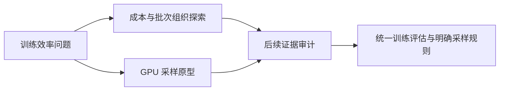
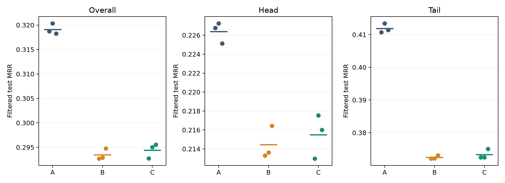
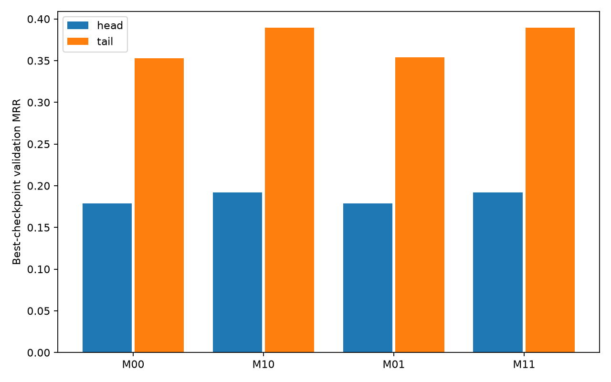
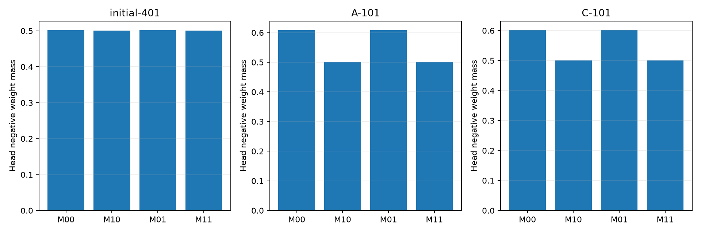

# muKG 负采样研究四次组会汇报说明稿

日期：2026-11-20。对象：了解机器学习、未参与本项目的导师与组员。四次汇报各约 10 分钟，问答另计。本轮主实验结果已定稿，M10 是当前说明中心，M11 是去重补充；汇报不启动新的实验。

## 使用方式与证据入口

每次六页，依次分配 1、1.5、2、2.5、2、1 分钟，累计时间为 0:00–1:00、1:00–2:30、2:30–4:30、4:30–7:00、7:00–9:00、9:00–10:00。页面内容供制作幻灯片，讲述稿可直接练习；证据和边界是讲者备注，不逐项朗读。时长包含读图、指示对照及短暂停顿，是编排目标，尚未经实际口头演练校准。

每次先回接前一个问题，再给出本次独立结论。主讲只保留关键点，完整区间、规则和历史记录放在备查部分；问答若涉及未检验范围，直接说明边界，不即兴扩大结论。

| 代号 | 入口 | 说明 |
|---|---|---|
| H1 | [历史研究故事](RESEARCH_STORY_2026-11-06.md)、[研究索引](RESEARCH_INVENTORY.md) | 早期探索、撤回登记及真实时间顺序 |
| E1 | [确认结果总结](CONFIRMATION_RESULTS_2026-11-17.md) | 12 种子最终结果、头尾指标、成本和恢复 |
| E2 | [机器可读汇总](../../output/results/confirmation_v1/analysis-01/summary.json) | 已定义的质量和速度比较 |
| E3 | [逐任务复算记录](../../output/results/confirmation_v1/analysis-01/recomputed_tasks.json) | 补充速度比较及 Q 任务墙钟 |
| E4 | [确认协议](CONFIRMATION.md) | 配置、配对、选模和测试闸门 |
| E5 | [机制结果](MECHANISM_RESULTS_2026-11-09.md)、[机制解释](MECHANISM_INTERPRETATION_2026-11-09.md) | 三种子四组验证及固定参数观测 |
| E6 | [旧 A/B/C 结果](FINAL_RESULTS_2026-11-08.md)、[解释记录](RESULTS_REFLECTION_2026-11-08.md) | 旧方案的效率与质量冲突 |
| E7 | [采样器](../../src/py/experiments/formal_v1/mechanism_sampling.py)、[训练和计时](../../src/py/experiments/formal_v1/confirmation_jobs.py) | 精确规则与计时边界 |
| E8 | [核验回执](../../output/results/confirmation_v1/execution-02/verification.json) | 已有 204 项任务与 7,202 个清单条目的核验 |

八张说明卡与正式论点的对应、相关工作差异见[论点与证据对应表](CLAIM_EVIDENCE_MAP_2026-11-17.md)。

## 八张重要说明卡

| 卡片 | 一句话结论与重要性 | 口头解释及主图／表 | 证据与边界 | 可能质疑与回答 |
|---|---|---|---|---|
| K1 研究动机 | 负采样既有执行开销，也定义训练输入，效率与质量需要一起检查 | 用一次训练 step 的流程解释候选、过滤、评分和更新 | H1、E7；早期重叠计时百分比不用于定量归因 | 是否所有 KGE 都如此？本研究只验证所测 muKG 配置 |
| K2 探索取舍 | 成本模型、CBP 和 GPU 原型是研究过程；审计决定哪些证据能保留 | 用并行探索时间线解释为何收窄主线 | H1；原型早于后续审计；撤回指标不再作为成果 | 为什么还讲失败？它解释后续设计，不能当成额外成功贡献 |
| K3 质量失败 | 旧候选明显加速，却未达到预设质量门槛 | A/B/C 规则表、测试质量图；C/A＝0.922624，[0.909673, 0.935760] | E6；质量 3 对，速度 5 对；不与最终种子合并 | 是否 GPU 导致掉点？差距在 A/B 已出现，仍混有规则与实现变化 |
| K4 方向组织 | 单条正样本内部怎样组织头尾负样本，会影响当前训练结果 | 四组规则图；验证 M10/M00＝1.092541，[1.088261, 1.096838] | E5；3 种子验证，不是 12 种子官方测试；softmax 因果尚未隔离 | 头尾总量都约各半为何不同？总体比例未描述每行的联合构成和权重竞争 |
| K5 M10 质量 | 最终 M10 达到历史 A 的 0.95 质量门槛 | 12 对测试比值及区间；M10/A＝0.9987，[0.9958, 1.0017] | E1–E2；预设次要比较；支持门槛，不证明完全等价 | 是否按测试选了方法？M10 原是备选，当前突出它是结果后的论文取舍，过程披露 |
| K6 速度分层 | 整体方案收益、匹配执行收益和完整任务成本不同 | S：8.4368 倍与 3.5532 倍；Q 均值之比 4.8644；T 解释来源 | E1–E3、E7；S 配对区间、Q 描述性均值、T 阶段同步分开 | 8.44 倍是否全是 GPU 收益？不是，纯粹归因设备会混入采样规则和实现变化 |
| K7 去重取舍 | M11 每轮多耗时约 21.98%，额外质量收益仍不明确 | M11/M10 质量＝1.0016，[0.9987, 1.0045]；轮耗时＝1.2198，[1.2179, 1.2216] | E1–E3；区间跨 1 不证明无效；仍报告 M11 原主判断成功 | 为什么不用质量均值略高的 M11？当前选择重视已达门槛后的效率取舍，不宣称 M10 质量更高 |
| K8 贡献与收敛 | 交付的是当前配置内的规则干预、质量与效率证据，以及明确的取舍 | 最终结论表与适用边界；204/204 任务完成 | E1、E4、E8；单方向已有先例；历史测试可见性及单配置范围保留 | 是否还要补实验？只有核心证据缺口或明确的新主张才另立设计，当前进入写作和交接 |

## 第一次汇报：为什么研究负采样，最初尝试了什么

独立问题：训练效率问题如何转化成一个可检验的研究问题？对应 K1、K2。结束时希望听众记住：优化必须说明改变了哪些规则，并用可靠测量和质量评估验收。

### 1.1 研究对象：负样本准备也是训练的一部分（1 分钟）

**页面内容：**一条正三元组、一组负三元组、一次参数更新；提问“更快生成这些输入，是否还能学得一样好？”

**图表：**使用下一页训练流程的简化版，只突出负样本准备区域。

**讲述稿：**这项研究从 muKG 的训练效率问题出发。知识图谱中的一条已知事实可以表示为头实体、关系和尾实体。训练时，我们还要构造一些替换头或尾的候选，帮助模型区分相对可信和不可信的事实。对每条正样本生成很多候选，会带来额外工作；改变候选的产生方式，也会改变模型收到的训练信号。这一系列四次汇报，先讲最初的探索和取舍，再讲质量问题、机制对照和最终结果。本次先回答：为什么负采样值得研究，以及我们怎样把这个问题收窄到可以验证的范围。

**证据与边界：**H1、E7；不把当前正式测量倒写成最初已经掌握的结果。

### 1.2 一次训练 step 在做什么（1.5 分钟）

**页面内容：**正样本批次、候选生成、过滤重试、张量与传输、评分与损失、反向和更新。

**讲述稿：**训练更新之前，首先要选出一批正样本。采样器生成替换实体，再按规则拒绝不合法候选，必要时继续补充。得到足够负样本后，还要构造张量、准备模型输入，再执行评分、损失和更新。因此，“采样快”可能来自减少 Python 循环、批量过滤、改变数据传输，也可能来自改变候选规则。早期记录提示这部分有研究价值，但某些计时区域相互包含，不能把它们简单相加为瓶颈占比。后来的正式实验把整个训练轮和分阶段计时分开，就是为了准确回答改进作用于哪里，而不把计时方式本身当成加速效果。

**证据与边界：**H1、E7；不使用旧重叠占比。

### 1.3 成本预测与批次组织的探索（2 分钟）

**页面内容：**“能否预测准备成本？”与“能否通过排序打包改善批次组织？”两个问题，各列一项探索及审计后的结论。

**讲述稿：**最初有一条路线是先估计不同训练输入的准备成本，再考虑如何组织批次。项目完成了成本特征、查表和排序打包等实现，也保存过一些看上去有利的结果。但实现了一个模块，并不自动证明它具备预测能力；一组相关性，也不能替代对未见真实批次的预测验证。后续审计发现，原有材料不足以支撑相应主张，同一有序输入下的 FFD 行为也等同于顺序切块。于是我们保留实现和探索记录，撤回不成立的性能与预测结论。这一步的意义在于确定哪些内容不能继续作为论文成果，而不是证明所有成本预测或调度方法都无效。

**证据与边界：**H1 的撤回登记；本页不展示撤回数字作为正面结果。

### 1.4 GPU 原型与审计如何汇合（2.5 分钟）

**页面内容：**并行探索时间线：成本／批次组织、GPU 原型 → 后续审计 → 统一规则和正式对照。

**讲述稿：**GPU 原型在后来的审计之前就已经开展，所以真实过程包含并行探索，不能写成先否定成本路线、然后才开始 GPU 研究。原型展示了批量候选和张量操作的实现可能性，但其规则与历史 CPU 路径不同。例如，它使用过仅尾替换和批次尾实体集合过滤。这种过滤不是按训练集完整三元组核对，既可能拒绝有效候选，也不能完整排除训练真三元组。审计还发现，旧实验在模型、数据划分和评估方面有不同限制。我们因此把原型经验与正式证据分开：原型说明做过什么，新的共同训练与评估流程才承担最终质量和速度判断。这样的取舍让研究目标变得清楚：不是把所有已有模块串成一个成功故事，而是对保留的方案取得可以解释的证据。

**证据与边界：**H1；图为研究顺序示意，非精确日期比例图。

### 1.5 正式实验需要同时约束什么（2 分钟）

**页面内容：**模型与数据相同；采样规则明确；整体与匹配对照分开；质量由链接预测评估。

**讲述稿：**新的正式设计首先固定模型和官方数据划分，再明确采样到底改变了什么。历史算法作为基线保留，新规则分别在 CPU 和 GPU 上执行。这样既能观察整套方案的变化，也能在规则匹配时检查执行路径收益。质量不能用短训练的 loss 下降替代：不同负样本分布下，loss 本身未必可直接比较。我们采用完整双向排名评估，通过验证集选 checkpoint，之后再做官方测试。计时也分为完整训练轮和独立阶段测量。本页的重点是，后续每个结果都要对应一个具体问题；对照能回答的范围，决定了结论可以写到哪里。

**证据与边界：**E4、E6；历史不同协议不合并统计。

### 1.6 本次结论与下一次问题（1 分钟）

**页面内容：**保留主线“明确规则 → 可靠计时 → 质量评估”；下一问“规则更明确、执行更快后，质量是否达到门槛？”

**讲述稿：**第一次汇报的结论是，负采样的研究需要同时关心执行和训练输入。早期成本、调度及 GPU 原型探索帮助我们发现问题，审计则限定了哪些证据可以进入正式论证。此后研究收敛到一个具体问题：在共同模型和评估条件下，GPU 采样能快多少，质量代价是多少。下一次讲 A/B/C 正式实验。它取得了明确加速，却发现质量没有达到预设门槛；这一结果决定了后续不能只继续优化速度。

**证据与边界：**H1、E6；本次不提前把候选称为质量保持方案。

### 第一次问答备查（不计入主讲）

1. **成本模型和 CBP 是否完全没用？**现有证据不足以保留原贡献，不能推导该类方法普遍无效。当前不继续挽救这一分支。
2. **为什么不引用最早的巨大加速倍数？**计时、模型、采样和数据条件不匹配，部分指标已撤回；正式结论引用后续共同协议测量。
3. **为什么质量不能看 loss？**采样分布变化会改变损失输入和权重；链接预测质量需要相同排名评估。
4. **工作是否只剩工程实现？**当前研究还包括规则干预、质量失败的定位、匹配执行和效率取舍；具体增量应结合已有工作评议，不预设算法新颖性。

## 第二次汇报：加速为什么没有保住质量

独立问题：A/B/C 对照揭示了什么，又留下什么不能归因的问题？对应 K3，回接 K1。本次结论是：质量差距在新规则 CPU 路径已经出现，需要继续区分规则因素。

### 2.1 从执行更快到质量达标（1 分钟）

**页面内容：**本阶段先问两个问题：训练是否更快，测试 MRR 是否达到历史 A 的 0.95？

**讲述稿：**上次说明了我们为什么重新建立共同训练与评估流程。本次报告旧 A/B/C 阶段的结果，它是后续机制研究的起点。这里的目标包含两部分：完整训练轮要缩短，预测质量也要达到历史基线的百分之九十五。这个门槛在本阶段结果出来前已经设定，不能因为结果不理想再修改。接下来会看到，加速确实出现了，但质量目标没有达成。请先记住本次只讨论旧阶段，不能把它的三种子质量结果与最终十二种子结果合并。

**证据与边界：**E6；旧阶段质量 3 对、S 速度 5 对、T 单种子。

### 2.2 三组分别改变什么（1.5 分钟）

| 组 | 采样设备及规则 | 主要比较用途 |
|---|---|---|
| A | 历史 CPU 算法 | 整体基线 |
| B | 新规则 CPU 张量采样，75 头＋75 尾 | 规则与 CPU 实现共同变化 |
| C | 相同新规则 GPU 张量采样 | 与 B 比较匹配执行路径 |

**讲述稿：**三组的训练模型都在 GPU 上。A 使用历史 CPU 采样，B 使用新的张量采样规则在 CPU 上生成负样本，C 在 GPU 上执行相同新规则。B 和 C 都是每条正样本固定七十五个头替换和七十五个尾替换，允许重复，严格过滤训练真三元组。A 保留历史方向选择、重复、过滤和重试行为。由此，A/C 回答整个方案的收益，B/C 回答相同规则下的执行路径差异。A/B 同时改变多项规则和 CPU 实现，不能靠这一个比较就把质量差距归因于方向或重复。这种区分是解释后面结果的前提。

**证据与边界：**E6；CPU／GPU 名称指采样位置。

### 2.3 速度结果先达成（2 分钟）

**页面内容：**旧 A/C＝8.453，[8.279, 8.630]；旧 B/C＝3.493，[3.456, 3.530]；完整训练轮与验证分开。

**讲述稿：**旧阶段的独立吞吐测量显示，相对 A，C 的完整训练轮约快八点四五倍；在规则相同的 B/C 比较中，GPU 路径约快三点四九倍。这两个结果来自五个配对种子，每个任务先平均自己的测量轮，再形成配对比值。它们说明两个层次的改进都存在，但数值不能互换。尤其不能把 A/C 的所有收益都归给 GPU，因为 A/B 之间也有变化。完整训练轮包含采样、传输和参数更新，但不包含定期验证。这个阶段已经看到，GPU 训练任务里的验证成本不可忽略，所以轮耗时加速也不能直接套到整个训练加验证任务。

**证据与边界：**E6；这是旧 A/B/C 阶段数字，不是最终 M10 的 8.44 倍和 3.55 倍。

### 2.4 官方测试揭示质量损失（2.5 分钟）

**页面内容：**总体 C/A＝0.922624，[0.909673, 0.935760]；上界低于 0.95，未达门槛。

**讲述稿：**这张图展示旧阶段三个种子的总体、头和尾测试 MRR。每个点是一项种子结果，横线是组均值。A 的总体 MRR 均值约零点三一九，B 和 C 约零点二九三到零点二九四。正式判断采用种子内 C/A 比值，其几何均值是零点九二二六，区间上界也低于零点九五，因此质量目标未达成。相对下降约百分之七点七四，指 MRR 比值下降，不是下降七点七四个百分点。B 和 C 都低于 A，而它们彼此较接近；尾查询差距更大。这一结果让研究问题发生了变化：执行更快已经有证据，下一步需要理解为什么新规则的质量不同，而不是继续把速度提高当作唯一目标。读图时注意三个面板纵轴尺度不同，正式判断以配对区间为准。

**证据与边界：**E6；最佳 checkpoint 由验证选定，每项测试一次；图不是置信区间图。

### 2.5 现有对照能定位到哪一步（2 分钟）

**页面内容：**A→B 已出现质量差距；B→C 未显示明确差距；方向、重复、过滤和重试仍待分解。

**讲述稿：**最关键的定位是，质量差距在 A 到 B 的阶段已经出现，不能简单说成 GPU 计算导致掉点。B/C 的配对测试比值约一点零零三，区间跨一，只能在当前三个配对内说两条匹配路径表现接近，不能宣称一般等价。另一方面，A/B 改动了多个因素，依然不能断定哪个因素承担全部差距。查阅规则和损失后，我们提出两个优先检查的问题：每条正样本内部混合头尾，是否改变了更新信号？允许重复，是否减少了有效候选多样性？过滤和重试差异也有记录，但应先观察触发情况，再决定是否需要专项干预。后续机制设计正是从这些明确的问题出发。

**证据与边界：**E6、E7；不要把候选假设写成该阶段已发现的机制。

### 2.6 从负结果进入因素对照（1 分钟）

**页面内容：**结论“加速有证据，质量未达标”；下一问“方向组织与去重哪个更重要？”

**讲述稿：**本次结果不是整项研究失败，而是对当前候选的清楚判断：它加快了训练，却没有达到原质量门槛。三组对照把问题进一步定位到新规则及其 CPU 实现变化，避免了把差距直接归因于 GPU。下一次我们用共同 GPU 路径做四组机制训练，单独组织方向与去重两个因素，看看哪些干预能解释并改善当前质量表现。这也说明旧质量失败必须留在研究故事里，它是后续实验的设计依据。

**证据与边界：**E6；新阶段是结果驱动的探索，不把后来的发现提前写进旧假设。

### 第二次问答备查（不计入主讲）

1. **为什么不直接延长 C 的训练？**固定预算曲线处于较低平台，但未证明充分收敛；延长训练也不能区分多项规则。当前优先做针对性干预。
2. **为什么 B/C 不是纯 GPU 内核收益？**它测完整训练轮，包含 CPU 采样结果传输和模型更新，是匹配执行路径比较。
3. **三个种子够不够？**本阶段按预设设计报告区间；质量未达门槛的证据明确，但对因素解释有限，后续另设机制与十二种子确认。
4. **头尾指标是否可以分别替代总体判断？**不可以；主门槛使用预设双向总体 MRR，头尾结果用于解释差异。

## 第三次汇报：方向组织与去重分别起什么作用

独立问题：在共同 GPU 路径中，怎样用可区分的干预解释质量差异？对应 K4、K7。本次使用三种子验证和固定锚点观测，不使用最终官方测试来选择候选。

### 3.1 把多项变化收窄为两个因素（1 分钟）

**页面内容：**方向：每行混合／每行单方向；重复：允许／同行唯一。

**讲述稿：**上次已经看到，质量差距在新的 CPU 规则中就出现了。本次把主要变化收窄成两个因素，在同一个 GPU 张量采样实现上比较。第一个因素是，一条正样本的负样本里同时放两类方向，还是每次先选一端再全部沿这一端生成。第二个因素是，是否要求这一行负三元组都不同。将它们交叉，就得到四组。这样可以对方向和去重分别提出问题，而不再只比较两个同时改了许多内容的完整系统。

**证据与边界：**E5；两个因素不覆盖历史 A 与新规则之间的全部差异。

### 3.2 四组怎样组成（1.5 分钟）

| 方向组织 | 允许重复 | 同行去重 |
|---|---|---|
| 每行 75 头＋75 尾 | M00 | M01 |
| 每条正样本随机选一端，150 个同向 | M10 | M11 |

**讲述稿：**M00 和 M01 都在每一行放七十五个头替换及七十五个尾替换，区别是 M01 去重。M10 和 M11 每次呈现一条正样本时，以各一半概率选择头或尾，然后保持一百五十个负样本同向，M11 再要求同行唯一。四组都严格过滤原正样本和训练真三元组，并使用共同的模型、初始化、正样本顺序与预算。注意“每条正样本随机选端”不是说一个实体永远只学头或尾，也不保证每个批次头尾数量恰好相等。它描述的是每行的组织方式。三个种子各跑四组、一千轮，每十轮完整验证，选模规则相同。

**证据与边界：**E5、E7；M01 的三种子证据不能说成后续十二种子确认。

### 3.3 方向组织取得主要质量改善（2 分钟）

**页面内容：**M10/M00 验证比值 1.092541，[1.088261, 1.096838]；M11/M01 为 1.090857，[1.077829, 1.104042]。

**讲述稿：**四组的验证结果显示，改变方向组织时，允许重复和要求唯一的两条比较都改善了质量。M10/M00 的最佳验证 MRR 配对比约增加百分之九点二五，M11/M01 也约增加百分之九。三个种子在这两项比较上都提高。图中头尾指标同时列出，避免只挑一个方向解释结果。相比之下，去重相关区间跨一，额外质量收益仍不明确。这支持把方向组织作为当前差异的主要干预因素。不过，这些是三个种子的验证训练，不能直接当作最终测试结果，更不能由此声称任何模型采用单方向都一定改善。下一步还必须确认候选相对历史 A 的官方测试表现。

**证据与边界：**E5；柱为组均值，不表示区间；配对结论来自对应表。

### 3.4 数量各半为何不等于权重各半（2.5 分钟）

**页面内容：**按行 softmax 加权；两个已训练锚点混合组头负项权重约 60%–61%；候选数量与实际权重不同。

**讲述稿：**为什么数量看起来均衡，训练结果却不同？当前自对抗损失会根据模型分数给一行负样本重新分配权重。因此，放七十五个头和七十五个尾，只能保证数量各半，不能保证两类样本在损失中的权重各半。在两个已训练参数锚点上，M00 的头负项平均拿到约百分之六十到六十一的权重。单方向组每行只有一种方向，整体头权重约一半，来自约一半正样本选头，而不是每行内部两类竞争。我们还计算了分方向归一化的即时梯度，确认这个操作会改变梯度。但这不是完整训练的独立损失对照。图里的参数来自不同轨迹，不能读成同一模型随时间演变。方向组织还会同时改变候选构成和梯度相关性，所以准确结论是：观测与权重竞争解释一致，尚未证明 softmax 是最终质量变化的唯一原因。

**证据与边界：**E5；各锚点面板纵轴不同；不是训练纵向曲线。

### 3.5 为什么同时保留 M10 和 M11（2 分钟）

**页面内容：**验证均值 M10＝0.290606，M11＝0.290712；M11/M10＝1.000360，[0.995498, 1.005246]；M10 更省时。

**讲述稿：**机制阶段按预先规定的最佳验证均值选候选，因此选择了均值略高的 M11。但两组差距非常小，M11/M10 区间跨一，并没有稳定优于 M10 的证据；M11 的训练开销也更高。因此我们没有把 M10 丢弃，而是将它预先列为省时备选，一起进入后续确认。这里要分清两个时间点：机制阶段按既定规则选中 M11；最终结果出来以后，论文叙事才把 M10 放在中心。这样可以说明实际效率取舍，同时保留原有的选择记录。我们不能用现在偏好 M10 的结果，反过来改写当时的主判断角色。

**证据与边界：**E5、E4；该阶段约 0.000105 的均值差不代表稳定质量优势。

### 3.6 候选需要怎样的最终确认（1 分钟）

**页面内容：**相对 A 的官方测试质量；相同规则 CPU/GPU 速度；同期 M00；独立阶段计时。

**讲述稿：**第三次汇报已经取得方向干预的验证证据，也得到一个机制解释线索。去重没有展示清楚的额外收益，因此最终确认同时测 M10 和 M11，并保留同期 M00。接下来要回答更直接的问题：候选能否达到历史 A 的测试质量门槛，整体训练能快多少，相同新规则在 GPU 上又比 CPU 快多少。第四次汇报将给出这组完整结果，并解释为什么当前可以结束主实验、转入报告与材料交接。

**证据与边界：**E4；后续使用新固定种子，不等于整个研究过程的全新盲测。

### 第三次问答备查（不计入主讲）

1. **是否已经证明 softmax 的因果机制？**没有。方向训练对照与固定参数观测回答不同层次；独立损失训练对照尚未开展。
2. **允许重复为什么可能没损失？**固定观测中的重复比例较低，去重影响也较小；这与结果一致，但不能推广为任意候选规模下都无需去重。
3. **为什么不以三种子验证直接宣布成功？**它用于探索和候选选择；相对历史 A 的正式测试及匹配 CPU/GPU 速度需要后续确认。
4. **单方向是否是新算法？**已有实现使用单方向负样本。当前贡献应说明本项目的具体对照发现和实现条件，不把规则本身称为首次提出。

## 第四次汇报：最终结果与当前交付

独立问题：M10 的质量与效率结果是什么，结论可以覆盖哪里？对应 K5–K8。本次明确区分最终实验结果、当前论文角色和原冻结统计身份。

### 4.1 最终确认怎样约束选择（1 分钟）

**页面内容：**204/204 项完成；质量 12 对；吞吐 12 对；阶段计时 6 对；先验证选模再测试。

**讲述稿：**最后一阶段完整完成了二百零四项任务。正式质量在十二个配对种子上测 A、M00、M10 和 M11；吞吐还有匹配 CPU 路径，阶段计时另用六个种子。每个任务独立进程，配对初始权重和正样本顺序，固定一千轮。全部质量训练及选模核验通过后才开放测试。原冻结协议的主判断是 M11，M10 是省时备选。今天以 M10 为说明中心，是结果后的论文取舍；质量保留次要比较身份，整体速度保留事后补充比较身份，原 M11 结果也完整保留。

**证据与边界：**E1、E4、E8；S/T/Q/E 分别为 72/36/48/48 项。

### 4.2 M10 达到质量门槛（1.5 分钟）

| 最终测试比较 | 配对比值 | 双侧 95% 区间 |
|---|---:|---|
| M10/A | 0.9987 | [0.9958, 1.0017] |
| M10/M00 | 1.0886 | [1.0853, 1.0918] |

**讲述稿：**最终测试中，M10 相对 A 的配对 MRR 比值是零点九九八七，区间下界约零点九九五八，高于原来零点九五的门槛。因此，在当前条件下，它达到预设的质量容忍要求。这个结论不是说两组严格相等，也不是 M10 的质量统计上更高。相对同期 M00，M10 的比值约一点零八八六，方向组织的改善也出现在十二对测试结果中。这里展示的是比值；组均值另外报告，不能把两种计算混用。我们同时保留头尾 MRR 和 Hits 指标，正式门槛仍使用预先定义的总体双向 MRR。

**证据与边界：**E1–E2；M10 质量是预设次要比较，区间未作多重比较校正。

### 4.3 两种训练轮速度分别回答什么（2 分钟）

| S 完整训练轮比较 | 几何均值 | 双侧 95% 区间 | 含义 |
|---|---:|---|---|
| A/M10-GPU | 8.4368 | [8.3489, 8.5255] | 相对历史 A 的整体方案收益 |
| M10-CPU/M10-GPU | 3.5532 | [3.5312, 3.5753] | 同规则执行路径收益 |

**讲述稿：**第一个速度结果是，相对历史 A，M10 的完整训练轮约快八点四四倍。第二个是，在同样新规则下，GPU 路径比 CPU 路径约快三点五五倍。两者都包含采样、传输和模型更新；两组模型都在 GPU 上训练。第一个比较包含规则与实现变化，第二个控制了新采样规则，所以不能把八点四四倍全部归因于设备。每项任务先平均五个测量轮，再对十二个种子形成配对比值和区间。比较对象也有限定：这是共同正式训练循环中的历史 A，不是与所有现成 KGE 框架的最优实现比赛。两个数字一起报告，才容易理解当前方案的真实收益来自什么层次。

**证据与边界：**E2–E3；A/M10 为事后补充分析；CPU/GPU 匹配规则和分布，不要求随机样本逐项相同。

### 4.4 时间省在哪里，完整任务又快多少（2.5 分钟）

**页面内容：**T 完整批采样 414.730→7.074 ms；完整 step 465.882→54.470 ms；Q 完整墙钟均值 8.0696→1.6589 h。

**图表：**主讲使用上述简表；[完整 T 阶段图](../../output/results/confirmation_v1/analysis-01/step-stages.png)和[验证随训练量与时间曲线](figures/confirmation-validation-2026-11-17.png)放备查。

**讲述稿：**独立阶段计时帮助解释加速。完整批中，A 的负样本生成约四百一十五毫秒，M10 约七毫秒；完整 step 从约四百六十六毫秒下降到五十四毫秒。主要节省出现在采样阶段，但阶段测量有同步开销，不能直接替代吞吐实验。再看包含验证和保存等工作的质量训练任务，A 的平均完整墙钟约八点零七小时，M10 约一点六六小时，均值之比约四点八六。它小于训练轮的八点四四倍，因为 M10 的验证已经占完整任务时间约百分之四十六点二。这个四点八六是描述性均值比较，没有配对区间；也不能称作达到同样质量所需时间的加速。备查曲线只展示已有验证记录，没有增加新的质量阈值。训练轮、阶段时间和完整任务成本应各自保留定义，这样读者才能知道何种实际流程可能得到何种收益。

**证据与边界：**E1、E3、E7；训练循环墙钟与 worker 完整墙钟不同；短批在备查表中单列。

### 4.5 M11 的结果与效率取舍（2 分钟）

| 最终比较 | 配对比值 | 双侧 95% 区间 |
|---|---:|---|
| M11/M10 测试 MRR | 1.0016 | [0.9987, 1.0045] |
| M11/M10 训练轮耗时 | 1.2198 | [1.2179, 1.2216] |

**讲述稿：**M11 的平均质量略高，但相对 M10 的质量比值区间跨一，额外收益还不明确。其完整训练轮耗时约为 M10 的一点二二倍，多耗时约百分之二十一点九八。因此，在质量已经达到历史门槛的前提下，M10 提供了更省时的选择，这就是我们把它放在论文中心的原因。这里没有宣布 M10 的质量高于 M11，也没有证明去重无效。M11 相对 A 的质量比值约一点零零零三，整体训练轮加速约六点九二倍，原冻结主判断两项目标均得到支持。保留这组结果，让读者能够自己判断去重带来的成本是否值得，而不是只看到我们偏好的候选。

**证据与边界：**E1–E3；所有次要区间未经多重比较校正。

### 4.6 研究结论与停止扩展的理由（1 分钟）

**页面内容：**当前配置内的质量与效率证据；M10 主线、M11 补充；主实验结束，进入报告、定稿和交接。

**讲述稿：**这项研究现在有了完整回答：在所测 muKG、TransE、FB15k-237 和 RTX 3070 条件下，M10 达到历史质量门槛，并取得整体和匹配执行路径加速。研究的价值在于具体规则干预、对照和取舍证据，单方向采样本身并非首次提出。测试集有历史可见性，固定一千轮也不等于证明充分收敛。当前核心任务已完成，继续堆同配置重复不能直接解决贡献定位或泛化问题。因此本轮转入完整报告与交接；只有发现影响核心结论的具体缺口，才另行设计补实验。

**证据与边界：**E1、E4、E8；结项不宣告旧新颖性审计门槛关闭。

### 第四次问答备查（不计入主讲）

1. **是否是真正全新盲测确认？**官方测试在旧阶段已使用。新阶段有冻结、验证选模和测试闸门，但不能消除历史可见性，新种子也不等于新数据。
2. **速度是否能推广到其他模型或机器？**没有该证据。结论限定为当前模型、数据、超参数、CPU 线程和 GPU；需要扩大主张时再设计对应扩展。
3. **CPU/GPU 是否已经证明质量完全一致？**没有。新匹配 CPU 路径只做 S/T；它们共用规则和分布，未完整做 Q/E，不能由此宣布训练质量等价。
4. **为什么现在可以结项？**主要质量、整体速度和匹配速度问题已有完整配对结果，规则与去重取舍也有证据。剩余工作是定稿、贡献评议与交接；若具体质疑影响核心结论，再提出最小补充。

## 通用备查与讲述规范

### 关键设计与统计

确认实验使用 TransE 250 维 L1、历史初始化、logistic_adv、margin 7、adv 2、Adam 0.0005、150 个负样本、10 个 CPU 线程、batch 5,000。每轮 54 个完整批和一个 2,115 条短批。Q 固定 1,000 轮，每 10 轮完整验证，最大双向验证 MRR 选 checkpoint，并列取最早；验证过滤 train＋valid，测试过滤 train＋valid＋test，平均并列排名。

S 种子 521–532，每项预热完整一轮后测五轮；T 541–546，独立阶段同步；Q/E 501–512，四个质量组。区间在种子内比值的对数尺度计算，再变回原尺度；推断单位是种子，不是轮、批或查询。M11 是原主判断；M10 的叙事角色调整、次要比较及事后速度分析均保留说明。

### 全部统计身份

| 材料 | 独立重复与用途 | 不能混用的地方 |
|---|---|---|
| 旧 A/B/C | 质量 3 对、S 5 对、T 1 种子 | 不与新阶段合并种子；8.45 倍是旧 C，不是最终 M10 |
| 四组机制训练 | 401–403 三对；验证选候选 | 不能称为官方测试或十二种子完整因素实验 |
| 固定参数观测 | 初始 401、历史 A-101、C-101 锚点 | 不是同一模型的纵向跟踪，批内样本不是独立训练重复 |
| 最终确认 | S 12 对、T 6 对、Q/E 12 对 | S 为速度主口径；T 用于解释；Q worker 墙钟和图中循环墙钟不同 |

### 执行完整性

正式任务最终 204/204 完成，共 206 次尝试。Q-A-504 两次因外部 GPU 干扰失败，原配置同种子的一次人工授权恢复从头完成；失败材料保留。成功 worker 累计约 161.20 小时，失败另约 5.03 小时，日历跨度约 175.84 小时；预检及最终分析另计。此前核验通过 204 项任务及 7,202 个清单条目。本轮说明稿没有重训或再次完整遍历原始归档。

### 图表与引用

旧阶段及机制三张图为封存产物的原字节副本，[来源与哈希清单](figures/research-series-figures.json)记录范围。最终验证三横轴图使用全部 4,800 次验证，[源码及输入身份](figures/confirmation-validation-2026-11-17.json)随图保存；粗线不是置信区间，连线不提供精确达标时间。

相关工作说明沿用 2026-11-17 的[定向核对](CLAIM_EVIDENCE_MAP_2026-11-17.md)。被标为未核实的细节继续保留边界；不声称检索穷尽、单方向首次提出或当前方案胜过所有 KGE 系统。旧稿中的成本预测、调度和夸大加速主张不进入正式汇报成果。

### 练习与删减规则

依次练习四次，记录实际页末时间；先保留每页结论和直接证据。超时时删去备查细节、重复背景和非关键数字，不删比较对象、统计身份或影响解释的限制。第三次若时间紧，权重图只讲两个已训练锚点；完整三个锚点和即时梯度细节转入问答。第四次主讲始终保留质量、整体训练轮和匹配路径三项结果，Q 墙钟作为不同口径补充。

当前状态为说明稿与逐页提纲，尚未实际试讲、制作 PPT 或安排组会日期；这些状态不影响已封存实验结果的身份。
