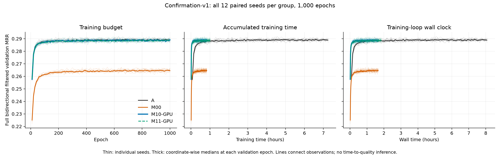

# muKG 负采样优化：以 M10 为中心的研究故事与论文框架

日期：2026-11-17。用途：导师讨论与论文框架；状态：基于已完成实验的研究主线整理，尚不是投稿定稿。

在当前 TransE、FB15k-237 和 RTX 3070 配置中，M10-GPU 的测试 MRR 相对历史 A 的配对比值为 **0.9987，双侧 95% 区间 [0.9958, 1.0017]**，下界高于原设计的 0.95 质量门槛；完整训练轮相对 A 加速 **8.4368 倍，[8.3489, 8.5255]**。相同采样规则下，M10 的 CPU/GPU 完整训练轮耗时比为 **3.5532，[3.5312, 3.5753]**。论文围绕这组质量与效率证据展开，M11 用于说明去重的成本和不确定收益。

本稿按用户确认的研究取舍组织：以效率与质量的实证研究为核心，先完成现有条件内的论证。结论不预先推广到其他数据、模型或硬件；只有出现影响核心论点的缺口时，再讨论补实验。

## 1. 要回答的研究问题

muKG 的负样本准备涉及候选生成、过滤、重试和张量构造。这些工作可以批量执行，但采样规则同时决定模型看到哪些负样本，以及这些负样本怎样参与损失。执行加快之后，必须检查质量变化，才能评价实际收益。

本研究的问题是：**在 muKG 的当前训练配置中，怎样组织并执行负采样，才能缩短训练时间，同时达到历史基线的质量门槛？**

三个主要问题分别对应质量、整体效率和匹配执行路径：M10 相对历史 A 的测试 MRR 是否达到原 95% 门槛；完整训练轮快多少；相同新采样规则在 CPU 与 GPU 执行时快多少。方向组织和去重对照解释设计取舍，阶段计时解释耗时来源。

论文突出 M10 是结果出来后的写作选择。原 confirmation-v1 冻结协议以 M11 为主判断，M10 为预先声明的省时备选；M10/A 质量为预设次要比较，A/M10 速度为事后补充比较。两者的论文篇幅可以调整，统计身份保持不变。原 M11 质量和速度两项主判断均获区间支持的结果仍完整保留。

## 2. 研究怎样走到当前方案

早期工作探索过采样成本预测、批次组织以及 GPU 原型。后续审计发现，成本预测与 CBP/FFD 相关材料不足以承担原有的预测、调度和负载平衡主张；旧性能分项也存在重叠。它们保留为研究过程及方法纠正，不作为当前贡献。GPU 原型早于后续审计，不能倒写成审计结束后才开始 GPU 研究。[历史阶段记录](RESEARCH_STORY_2026-11-06.md)

之后的 A/B/C 实验采用统一训练与评估，发现旧 GPU 候选虽然加快训练，但测试 MRR 相对历史 A 下降约 7.74%，未达到质量门槛。该结果说明，对执行路径的优化需要同时检查采样规则及预测质量。旧结果有自己的种子和协议，保留为动机，不合并进当前 12 对结果。[旧正式结果](FINAL_RESULTS_2026-11-08.md)

机制阶段随后区分两个因素：每条正样本的方向组织，以及同行负样本是否去重。M00/M01 每行固定 75 头和 75 尾，M10/M11 每条正样本随机选一端并保持 150 个负样本同向；M01/M11 增加同行唯一约束。三个配对种子的四组验证训练支持方向组织是当前质量差异的主要因素，去重的额外质量收益不明确。按该阶段预设的最佳验证均值选择了 M11，M10 则作为更快的备选进入后续确认。[机制结果](MECHANISM_RESULTS_2026-11-09.md)

最终确认阶段完整完成 204 项任务，在新的固定种子上取得质量、匹配 CPU/GPU 吞吐及独立阶段计时。当前写作选择 M10 作为主要结果，是因为其达到质量门槛且比 M11 更省时；并非将 M11 的原选择删除，也不把此次角色调整追溯为测试前决定。[确认结果总结](CONFIRMATION_RESULTS_2026-11-17.md)

## 3. 方法及对照怎样支持判断

M10 每次接收一条正样本时，以各 1/2 概率选择替换头或尾，生成 150 个同向负样本；候选允许重复，严格拒绝原正样本和训练集真三元组，最多重试 64 轮，耗尽时明确失败。候选生成、三元组过滤和重试使用张量操作。头尾在每条正样本内部的联合组织发生改变，即使总体上都使用约一半头替换，也不代表训练信号相同。

| 对照 | 回答的问题 | 解释限制 |
|---|---|---|
| 历史 A ↔ M10-GPU | 整体方案的质量与完整训练轮收益 | 多项规则及实现共同变化，不能隔离方向或纯设备效应 |
| 同期 M00 ↔ M10-GPU | 共同 GPU 路径中，75+75 与单方向组织的质量差异 | 结论针对该干预及当前损失、配置 |
| M10-CPU ↔ M10-GPU | 相同新规则的执行路径效率差异 | 两组模型均在 GPU 训练；CPU 采样组含负样本传输 |
| M10-GPU ↔ M11-GPU | 同方向规则下，额外去重的质量和成本 | 未明确支持质量收益不等于证明去重无效 |
| 三种子四组机制训练及固定参数观测 | 区分方向／重复因素，提供权重与梯度解释 | 验证结果与测试结果分开，局部梯度与完整训练因果分开 |

全部确认组共用 FB15k-237 官方划分、TransE 250 维 L1、历史初始化、logistic_adv、margin 7、adv 2、Adam 0.0005、150 个负样本、10 个 CPU 线程及 batch 5,000。同种子配对初始化和正样本顺序。Q 固定训练 1,000 轮，每 10 轮完整验证，以最高双向验证 MRR 选 checkpoint，并列取最早轮次。

验证过滤 train＋valid，测试过滤 train＋valid＋test，采用平均并列排名，报告总体、头、尾 MRR 和 Hits@1/3/10。全部 48 项 Q 及选模校验通过后才开放 E。配对区间以种子为单位，不能把查询或五个测量轮当成额外独立重复。

## 4. 已有结果支持的三层贡献

### 4.1 方向组织与质量的实证发现

12 个种子的测试 MRR 算术均值分别为 A 0.319469、M00 0.293104、M10 0.319066、M11 0.319577。正式比较采用种子内比值，区别于这些组均值的直接相除。

M10/A 配对比值为 0.9987，[0.9958, 1.0017]，支持当前 0.95 质量门槛；M10/M00 为 1.0886，[1.0853, 1.0918]，表明同期方向组织干预取得约 8.86% 的 MRR 相对改善。前者回答相对历史基线的质量保留，后者回答共同 GPU 路径内的方向差异，两个对照不能互相代替。

可用贡献措辞是：**在指定训练条件下，对方向组织进行对照，识别影响质量的实现选择，并得到达到历史质量门槛的 M10 方案。** 目前不把单方向规则本身称为新算法。RotatE 官方代码已经使用单方向负样本和头尾批次交替；本研究按每条正样本随机选端，选端单位及跨样本相关性不同，但这种差异本身也不足以证明新颖性。[官方采样代码](https://github.com/DeepGraphLearning/KnowledgeGraphEmbedding/blob/master/codes/dataloader.py)

### 4.2 分开量化整体方案与执行路径收益

| 结果层次 | M10 结果 | 论文解释 |
|---|---|---|
| 完整训练轮，相对历史 A | 8.4368 倍，[8.3489, 8.5255] | 主要速度结果，固定训练量，包含采样、传输和模型更新 |
| 同规则 CPU/GPU 完整训练轮 | 3.5532 倍，[3.5312, 3.5753] | 匹配执行路径收益，模型都在 GPU |
| 包含验证等开销的 Q 完整任务 | A 均值 8.0696 h，M10 1.6589 h；均值之比 4.8644 | 描述性实际成本，无配对区间，不能替代 S 的主要速度结果 |

独立 T 计时中，完整批的负样本生成由 A 的约 414.730 ms 降至 M10 的 7.074 ms，完整 step 由 465.882 ms 降至 54.470 ms。时间构成支持采样是主要节省来源。T 的阶段同步、完整批与短批分项只服务于解释；不把采样阶段之比写成整个训练加速，也不把 T 与 S 直接混算。

M10 的验证平均约 0.7671 小时，占 Q 完整墙钟约 46.2%。因此，采样加速后，固定频率的完整验证成为显著成本，完整任务的收益小于训练轮收益。该现象限定于本协议的评估频率，不据此在当前工作中改变验证规则或启动验证优化。

分层测量使研究者能够判断收益来自哪里。已有 DGL-KE、Marius 等工作也评价训练系统的效率与质量，因此“同时测速度和质量”不单独作为新颖性主张；本研究的增量需要由具体干预、对照和条件来说明。[定向文献核对及完整计时定义](CLAIM_EVIDENCE_MAP_2026-11-17.md)

### 4.3 去重的额外成本与不确定收益

M11/M10 测试 MRR 比值为 1.0016，[0.9987, 1.0045]，点估计略高，区间跨 1；M11/M10 轮耗时比为 1.2198，[1.2179, 1.2216]，即 M11 每轮多耗时约 21.98%。因此，当前证据支持把 M10 作为省时方案重点报告，并把 M11 用作去重取舍的补充。

该解释保留 M11 在原确认协议中的成功主判断：M11/A 质量比为 1.0003，[0.9980, 1.0027]，完整训练轮加速 6.9167 倍，[6.8513, 6.9827]。不能因为叙事选择 M10 就隐藏 M11、M00 或旧质量失败。全部次要区间为逐项未作多重比较校正的 95% 区间。

## 5. 机制解释可以写到哪里

负样本数量各半，不保证它们在自对抗损失中的权重各半。在两个已训练参数锚点，M00 的头替换负项取得约 60%–61% 的权重；将归一化改成分方向各给一半权重，会改变即时梯度。这些观测有助于解释，为何每行混合方向和每行单方向可能产生不同训练信号。[机制解释](MECHANISM_INTERPRETATION_2026-11-09.md)

不过，方向干预也改变候选构成和梯度相关性；当前未独立控制这些路径。锚点来自不同训练轨迹，不构成同一模型的纵向跟踪。因此正文可以写“与自对抗权重竞争的解释一致”，不能写“已经证明共享 softmax 是质量下降的唯一原因”。该损失的自对抗加权本身也已有来源。[RotatE §3.3](https://arxiv.org/pdf/1902.10197)

当前实证主线不以补齐整个机制因果链为完成条件。只有讨论后决定把机制因果提升为核心主张，才另行设计独立损失控制训练。

## 6. 质量随训练量和时间的表现

三幅图使用相同的 48 项 Q、4,800 次完整验证，横轴依次为轮数、累计训练轮时间和训练循环墙钟。细线是全部种子，粗线是每个验证轮次的横纵坐标中位数，不代表某个实际轨迹或置信区间。M10 加粗，M11 虚线；A 与 M00 同时保留。

曲线是对已有日志的描述性整理，未选择新的质量阈值，未估算两次验证间的真实达标时间。右图墙钟包含训练循环内的验证和记录，排除模型构建等任务前段与收尾，不等于 Q 完整任务墙钟。固定 1,000 轮的曲线不证明充分收敛，正式质量判断仍使用验证选模后的官方测试结果。[绘图来源、复现方法及身份](CLAIM_EVIDENCE_MAP_2026-11-17.md)

## 7. 论文结构与材料分配

暂拟标题：**muKG 中负采样方向组织的质量与效率取舍：一项受控实证研究**。标题不承诺新采样算法或跨平台普适结论。

| 章节 | 要完成的论证 | 对应材料／建议图表 |
|---|---|---|
| 1 引言 | 说明实际效率问题、旧质量失败、三个研究问题及有限贡献 | 旧 A/B/C 作为动机；M10 质量与两类速度摘要；避免旧重叠百分比 |
| 2 背景与相关工作 | 区分方向组织、候选分布、自对抗权重及系统执行，定位与最近工作的关系 | 证据对应表 §3；区分 RotatE、批内共享、缓存、多跳查询、磁盘系统及补全检索 |
| 3 方法与实验设计 | 精确定义 A、M00、M10、M11 和匹配 CPU/GPU；说明冻结、配对、选模和统计角色 | 六路径规则表、任务阶段表、种子与测试闸门；披露 M10 事后叙事选择 |
| 4 结果 | 按质量→整体轮耗时→同规则路径→时间构成→去重顺序回答问题 | 总体／头尾 MRR、Hits、配对比值及区间；S/T 图；Q/E 成本表及本稿验证曲线 |
| 5 讨论与有效性威胁 | 给出权重解释线索、与已有工作差异、尚不能推出的结论和补充条件 | 三种子因素与固定锚点观测；历史测试可见性、固定预算、单配置和恢复披露 |
| 6 结论 | 回答三个问题，限定结论，不把工程成功直接写成算法新颖性 | M10 质量门槛、8.44 倍整体训练轮和 3.55 倍匹配路径收益；M11 取舍 |

章节详略随导师反馈调整，目前不预设投稿场所及篇幅。历史探索、已撤回主张和完整恢复记录放入必要的背景／附录，不占据方法贡献中心。

## 8. 适用边界与完成标准

结论限定于 TransE 250 维 L1、当前自对抗损失与超参数、FB15k-237、150 个负样本、batch 5,000、10 个 CPU 线程及同一张 RTX 3070。12 个种子的区间反映这些条件下的随机变异，不能覆盖新数据、新模型、新硬件或所有实现选择。

FB15k-237 测试集在旧阶段已使用。当前测试闸门保证本阶段按冻结任务和验证选模执行，不能消除整个研究过程的历史可见性。三种子机制阶段是结果驱动探索，新确认种子是新的随机重复，不等于新测试数据或完整独立盲复现。

匹配 CPU/GPU 指规则和概率分布一致，不要求随机样本逐项相同；CPU 路径只做 S/T，没有独立的完整质量训练证据。A 保留历史过滤／重试／兜底行为，M 系列规则不同；A→M10 的整体比较不能完全分解为单个因素。

全部正式任务最终齐全，仍须披露两次外部 GPU 干扰失败和一次超出自动重试额度的人工恢复。成功 worker 累计约 161.20 小时，失败约 5.03 小时，日历跨度约 175.84 小时；这些执行成本不能被成功任务均值隐藏。[恢复与成本记录](CONFIRMATION_RESULTS_2026-11-17.md)

这一轮完成标准是：导师能够沿着“问题→干预→对照→结果→解释范围”检查每项主张，且每个数字和方法事实都能回到 [论点与证据对应表](CLAIM_EVIDENCE_MAP_2026-11-17.md) 的材料。实验效果已有证据，论文贡献是否足够仍留待导师结合最近工作判断；旧 C1 新颖性门槛不宣告关闭。

当前没有必须立即启动的新训练。若最近工作比较暴露必要基线、核心对照存在混杂、需要扩大适用范围或升级机制因果主张，再提出相应最小实验：先写疑问和结果如何改变结论，再确定组别、固定统计与评估规则、预算和停止条件，讨论后另行冻结。不将补实验作为无限扩展的默认步骤，也不以收窄措辞掩盖真实的核心证据缺口。
